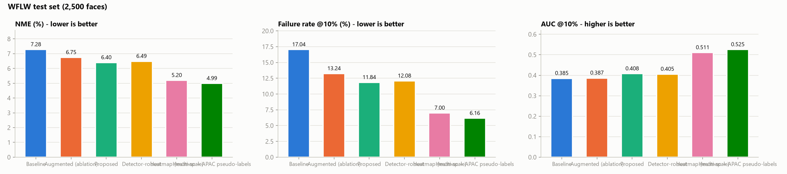
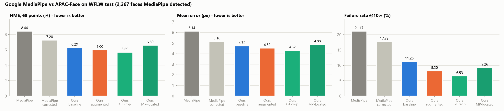
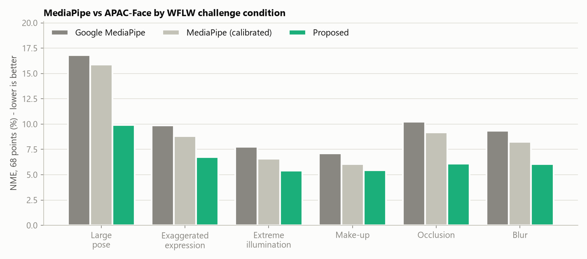
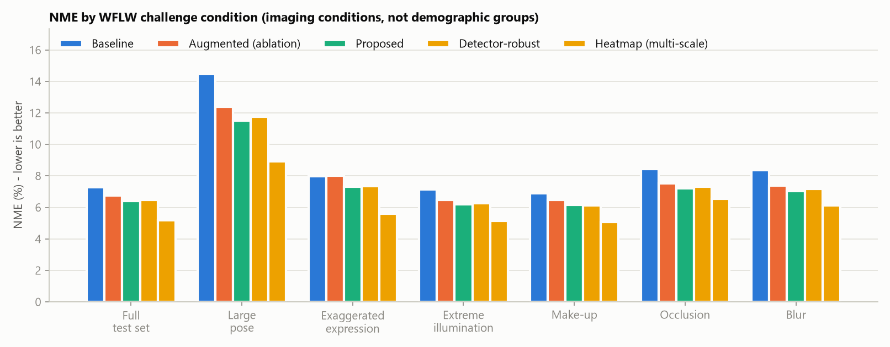
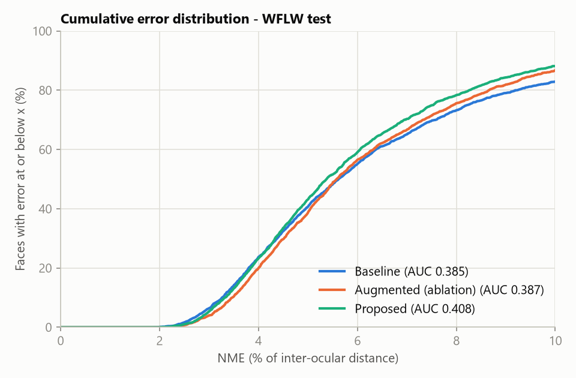
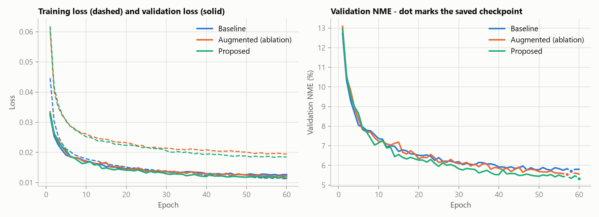
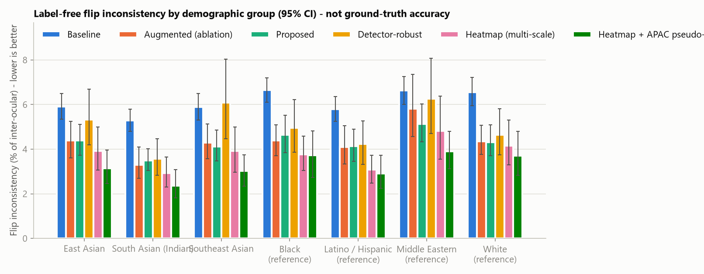
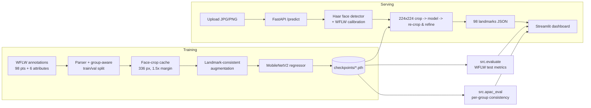

# APAC-Face: A Demographically Robust Facial Landmark Detection System

APAC-Face is a complete, trained 98-point facial landmark detector with a measured baseline comparison,
a robustness analysis, a REST inference API and an interactive dashboard.

> **Problem statement (Cross-Cutting Computer Vision - APAC-Diverse Facial Landmark Detection Model).**
> Existing facial landmark detectors are trained predominantly on Caucasian faces and lose accuracy on
> East, South, and Southeast Asian facial morphology. Build a landmark detection model that performs
> accurately across these populations and quantify the improvement over current baselines.

### What is measured, and what is not

| Question | Data | Evidence type |
|---|---|---|
| How accurate is the model, and how much better than the baseline? | WFLW test set (2,500 faces, ground truth) | **Accuracy** (NME, failure rate, AUC) with a paired bootstrap test |
| Is it more accurate than Google MediaPipe? | Same WFLW test faces, 68 common points | **Accuracy** vs MediaPipe Face Landmarker, also after correcting MediaPipe's labelling-style offset |
| Does it hold up under hard imaging conditions? | WFLW pose / expression / illumination / make-up / occlusion / blur subsets | **Accuracy** per condition. These are *imaging conditions, not demographic groups* |
| Does it behave consistently across East, Southeast and South Asian faces? | FairFace-style APAC images, group labels from the dataset's file names | **Label-free consistency** (flip consistency, crop stability). *Not accuracy*: these images have no landmark ground truth |
| True per-population accuracy | An annotated APAC test set | Supported by `src/apac_eval.py --annotations`. Needs annotated data, which this repository does not have yet |

Ethnicity is never inferred from facial appearance. WFLW has no demographic labels, so WFLW results alone
do not prove APAC fairness.

<!-- RESULTS:START -->
## Results

All numbers below were measured on this machine (RTX 4050 Laptop GPU, 6 GB). They are produced by
`python -m src.evaluate` and `python -m src.apac_eval` and stored in `results/`. Nothing is hand-entered.
The committed checkpoints were trained with PyTorch 2.6.0 (CUDA 12.4) and evaluated with PyTorch 2.14.1
(CUDA 12.6). The per-epoch training record of each run is in `results/history_<experiment>.json`.

### WFLW test set (2,500 faces, never used for training or checkpoint selection)

| Model | NME | Median NME | FR@10% | AUC@10% | MAE (px) | Improvement vs baseline |
|---|---|---|---|---|---|---|
| Baseline | 7.28% | 5.62% | 17.04% | 0.385 | 3.25 | - |
| Augmented (ablation) | 6.75% | 5.58% | 13.24% | 0.387 | 3.07 | 7.3% |
| **Proposed** | **6.40%** | **5.38%** | **11.84%** | **0.408** | **2.93** | **12.1%** |

- **Proposed vs baseline:** mean NME drops by 0.88 points (paired bootstrap 95% CI 0.77 to 1.00; none of the
  2,000 bootstrap resamples showed no gain, i.e. p < 0.0005). The failure rate falls from 17.0% to 11.8%.
- **Where the gain comes from:** augmentation alone gives 7.3%. Attribute-balanced sampling adds a further
  5.2% over augmentation (0.35 points, 95% CI 0.30 to 0.40), so both parts contribute.
- **Latency:** 12.4 ms median per face on the GPU, 21.5 ms on the CPU (batch 1, 224x224, fp32). All three
  models share the architecture, so their latency is identical.
- Each model was trained once (seed 42). The bootstrap covers test-set sampling, not seed-to-seed variance.



### Against Google MediaPipe (WFLW test, real ground truth)

`python -m src.mediapipe_baseline` runs Google's MediaPipe Face Landmarker (478-point mesh, model
`face_landmarker.task`, mediapipe 1.1.1) on every WFLW test face. MediaPipe and APAC-Face (98 points) are then
reduced to the common **68-point iBUG layout** and scored against the manual annotations reduced the same way.
MediaPipe detected 2,267 of 2,500 faces (90.7%); every number below uses those 2,267 faces for every method.

| Method | NME, 68 pts | Inner face (no jaw) | Mean Euclidean Error | Failure rate (NME > 10%) | Points > 8% |
|---|---|---|---|---|---|
| Google MediaPipe | 8.44% | 6.44% | 6.14 px | 21.2% | 32.3% |
| MediaPipe, offset-corrected | 7.28% | **5.46%** | 5.16 px | 17.7% | 24.9% |
| **APAC-Face, same face location as MediaPipe** | 6.60% | 5.92% | 4.88 px | 9.3% | 22.6% |
| APAC-Face, standard WFLW crop | **5.69%** | 5.22% | **4.32 px** | **6.5%** | **20.8%** |

- **Same face location** is the fair head-to-head and what the web app runs: our crop is built from MediaPipe's own
  detection (a 3-number box mapping learned on WFLW training faces, one pass). The standard WFLW protocol instead
  crops around the annotated face, which no detector-based system gets in practice.
- **Offset-corrected MediaPipe** gives MediaPipe its best case. Its mesh follows a different landmark convention
  from manual annotation (most visibly on the jaw). So the median per-point offset to ground truth, in an
  eye-aligned frame, is learned on 1,914 WFLW *training* faces and added to its test predictions.
- **Against MediaPipe as shipped**, APAC-Face is better everywhere: NME −21.8% with the same face location
  (95% CI of the drop 1.74–1.93 points), −32.6% with the standard crop. Inner-face error is also lower (−8.1% and
  −18.9%, both p < 0.0005).
- **Against offset-corrected MediaPipe**, APAC-Face is still better on all 68 points (−9.3% with the same face
  location, CI 0.57–0.77 points). The gain comes from the jaw line (8.64% vs 12.71%). **On the inner face points
  the corrected MediaPipe is better** with the same face location (5.46% vs 5.92%, significant). With the
  standard crop the two are statistically tied (−4.4%, p = 0.19).
- **Caveat:** APAC-Face was trained on WFLW's annotation convention, which favours it on this test set. The gap
  between "same face location" and "standard crop" (6.60% vs 5.69%) shows that a detector-robust model is the
  next improvement.

| Region (normalised error) | MediaPipe | MediaPipe corrected | APAC-Face, same location |
|---|---|---|---|
| Jawline | 14.43% | 12.71% | **8.64%** |
| Eyebrows | 8.98% | 6.87% | **6.79%** |
| Nose | 5.54% | **4.99%** | 5.29% |
| Eyes | 5.35% | **4.70%** | 5.19% |
| Mouth | 6.24% | **5.43%** | 6.22% |





### Robustness across WFLW challenge conditions (imaging conditions, not demographic groups)

| Condition | Faces | Baseline NME | Proposed NME | Relative improvement | 95% CI of NME drop (pts) |
|---|---|---|---|---|---|
| Large pose | 326 | 14.47% | 11.51% | 20.5% | 2.47 to 3.53 |
| Exaggerated expression | 314 | 7.98% | 7.33% | 8.2% | 0.41 to 0.92 |
| Extreme illumination | 698 | 7.16% | 6.20% | 13.4% | 0.74 to 1.18 |
| Make-up | 206 | 6.90% | 6.15% | 10.9% | 0.45 to 1.10 |
| Occlusion | 736 | 8.45% | 7.21% | 14.6% | 0.99 to 1.48 |
| Blur | 773 | 8.38% | 7.03% | 16.0% | 1.07 to 1.62 |

The proposed model improves every condition, and the gap between the hardest condition (large pose) and the
full test set shrinks from 7.2 to 5.1 points. Augmentation alone slightly *hurt* exaggerated expressions
(8.02% vs 7.98%); balanced sampling recovered that.







<!-- APAC:START -->
### APAC demographic groups: label-free consistency (not accuracy)

300 randomly sampled 448x448 face crops per group from the FairFace-style APAC archive (2,100 images). Group
labels come from the archive's file names. These images have **no landmark ground truth**, so the two
metrics below measure stability, not correctness. Lower is better; brackets are 95% bootstrap CIs.

| Group | Haar detection | Flip inconsistency: baseline | proposed | Crop instability: baseline | proposed |
|---|---|---|---|---|---|
| East Asian | 81% | 5.91% [5.35, 6.49] | 4.39% [3.72, 5.12] | 4.32% | 2.15% |
| Southeast Asian | 82% | 5.89% [5.32, 6.49] | 4.11% [3.47, 4.85] | 4.26% | 1.97% |
| South Asian (Indian) | 89% | 5.28% [4.80, 5.80] | 3.50% [3.05, 4.02] | 4.10% | 1.80% |
| White (reference) | 77% | 6.56% | 4.32% | 4.54% | 2.08% |
| Black (reference) | 75% | 6.65% | 4.64% | 4.57% | 2.11% |
| Latino / Hispanic (reference) | 85% | 5.80% | 4.13% | 4.14% | 1.91% |
| Middle Eastern (reference) | 80% | 6.63% | 5.13% | 4.73% | 2.54% |

How to read this, without over-claiming:

- **The proposed model is more stable in every group:** flip inconsistency falls 26-34% and crop
  instability 50-56% in the three APAC groups (paired bootstrap p < 0.0005 in each). Caveat: the
  augmentation trains exactly these invariances (flips, shifts, scale), so a large improvement is expected
  and is *not* by itself evidence of better accuracy on APAC faces.
- **APAC groups are not worse off than the reference groups.** The proposed model's mean flip inconsistency
  over the three APAC groups (4.00%) is at or below White (4.32%), Black (4.64%) and Middle Eastern (5.13%).
- **No reliable ranking among the APAC groups.** Their confidence intervals overlap. The max-min spread
  across APAC groups is 0.63 points for the baseline and 0.89 for the proposed model.
- **The face detector varies more than the landmark model.** The Haar detector finds 75-89% of faces
  depending on the group. Faces it misses fall back to a centre crop.
- **What the problem statement asks for**, accuracy per population, still requires an annotated APAC test
  set. `python -m src.apac_eval --annotations ...` computes it as soon as one exists.


<!-- APAC:END -->
<!-- RESULTS:END -->

## System architecture



**Model.** Input 224x224x3 -> ImageNet-pretrained MobileNetV2 features -> global average pooling ->
Linear(1280->512) -> ReLU -> Dropout(0.2) -> Linear(512->196) -> 98 x (x, y) in [0, 1]. The head bias starts at
the mean training face. About 2.98 M parameters.

**Crop protocol.** Training and test crops are squares centred on the landmark extent, with side = 1.2 x the
longer side (the standard WFLW protocol). For uploaded photos, an OpenCV Haar detector box is mapped to that
crop with a calibration fitted on WFLW training images (median over 562 matched faces: side x 1.03, centre
shifted down by 0.15 x box height). After each prediction the crop is recomputed from the predicted
landmarks exactly as in training, and the face is predicted again. The number of passes was tuned on the
WFLW **validation** split with real detector boxes, not on the test set:

| Refinement passes | NME from Haar boxes (511 val faces) | NME from a loose box (detector-miss fallback) |
|---|---|---|
| 0 | 5.98% | 20.57% |
| 1 | 5.27% | 11.59% |
| **2 (default)** | **5.11%** | **9.36%** |
| 3 | 5.03% | 8.86% |

The Haar detector found 71% of WFLW validation faces. WFLW is deliberately hard (profiles, occlusion); on
FairFace-style APAC crops the detection rate per group is reported in `results/apac_consistency.json`.

## Experiments

All three configurations share the backbone, optimiser (AdamW, backbone lr 1e-4, head lr 1e-3), smooth-L1
loss (beta 0.01 in normalised coordinates), ReduceLROnPlateau schedule, early stopping (patience 10 on
validation NME), mixed precision, seed 42 and a 60-epoch budget. Only the training data pipeline changes:

| Experiment | Augmentation | Sampling | Purpose |
|---|---|---|---|
| `baseline` | none | uniform | standard fine-tuning baseline |
| `augmented` | flip (with left/right index remapping), rotation +/-20 deg, scale +/-10%, shift +/-5%, brightness/contrast +/-25%, blur, grayscale, synthetic occlusion | uniform | ablation: effect of augmentation alone |
| `proposed` | same as `augmented` | attribute-balanced | full method |

Attribute-balanced sampling up-weights faces with rare WFLW conditions: each attribute gives a face the
weight 0.5 / P(its value), weights are averaged over the six attributes, and the average is raised to the
power 0.5.

**Metrics.** NME = mean point-to-point error / inter-ocular distance (outer eye corners, points 60 and 72).
FR@10% = share of faces with NME > 10%. AUC@10% = area under the cumulative error curve up to 10%.
MAE = mean absolute coordinate error in original-image pixels. Latency = median forward time at batch size 1.
Invalid predictions (NaN/inf) count as failures. Relative improvement = (NME_baseline - NME_proposed) /
NME_baseline x 100.

## Repository layout

```
APAC-Face/
├── config.yaml              all hyperparameters, paths and experiment definitions
├── requirements.txt
├── src/
│   ├── dataset.py           WFLW parser, group-aware split, face-crop cache, PyTorch dataset
│   ├── augmentations.py     one affine matrix for image + landmarks; flip index remapping
│   ├── landmarks.py         98-point mirror permutation, mesh topology, drawing
│   ├── model.py             MobileNetV2 regressor, checkpoint save/load
│   ├── train.py             training loop: AMP, early stopping, resume, balanced sampling
│   ├── metrics.py           NME, MAE, FR, AUC/CED, bootstrap tests
│   ├── evaluate.py          WFLW test evaluation, tables and figures
│   ├── apac_eval.py         per-group consistency (and accuracy, given annotations)
│   ├── inference.py         face detection, crop, predict, refine; CLI
│   ├── live.py              webcam / video mode with frame-to-frame face tracking
│   ├── mediapipe_baseline.py Google MediaPipe benchmark on WFLW (68 common points)
│   ├── export_web.py        ONNX export + data for the web app
│   ├── plotting.py          report figures
│   └── utils.py             config, seeding, device, JSON helpers
├── backend/main.py          FastAPI service
├── frontend/                Streamlit dashboard (app.py + views/)
├── web/                     Faceify web app: index.html, js/, styles/, models/ (ONNX + MediaPipe), data/
├── checkpoints/             trained inference weights + detector calibration
├── results/                 metrics, CSV tables, figures, training logs
├── scripts/                 train_all.ps1, run_app.ps1
├── tests/                   pytest suite (no dataset needed except one optional test)
└── data/                    datasets (git-ignored, see data/README.md)
```

## Installation

Developed and tested on Windows 11 with Python 3.13 and an NVIDIA RTX 4050 Laptop GPU (6 GB). It needs
Python >= 3.10. CUDA is used when available, otherwise the CPU.

```bash
python -m venv .venv
# Windows: .venv\Scripts\activate      Linux/macOS: source .venv/bin/activate
pip install torch torchvision --index-url https://download.pytorch.org/whl/cu126
pip install -r requirements.txt
```

For the MediaPipe benchmark and the web export:

```bash
pip install mediapipe --no-deps     # its opencv-contrib-python 5.x dependency would replace opencv-python<5
pip install absl-py flatbuffers onnx onnxruntime onnxscript
```

`requirements-lock.txt` pins the exact versions this project was tested with. Use it instead of
`requirements.txt` to reproduce the environment exactly.

## Dataset setup

1. Download WFLW from the links in the [LAB repository](https://github.com/wywu/LAB): `WFLW_images.tar.gz`
   (Google Drive / Baidu) and `WFLW_annotations.tar.gz`.
2. Extract both into `data/WFLW/`:

   ```bash
   tar -xzf WFLW_images.tar.gz -C data/WFLW
   tar -xzf WFLW_annotations.tar.gz -C data/WFLW
   ```

3. Parse, split and cache face crops (also checks the attribute flags against the official subset lists and
   writes `results/dataset_samples.png`):

   ```bash
   python -m src.dataset
   ```

If the files are missing, every command prints the expected layout instead of crashing. See
[data/README.md](data/README.md).

## Training

```bash
python -m src.train --experiment baseline
python -m src.train --experiment augmented
python -m src.train --experiment proposed
python -m src.train --experiment proposed --resume      # continue an interrupted run
python -m src.train --experiment baseline --smoke       # 2-epoch pipeline check
```

Or run everything (dataset cache, the three trainings, detector calibration, evaluation) in one go on Windows:

```powershell
powershell -ExecutionPolicy Bypass -File scripts\train_all.ps1
```

Each run writes `checkpoints/<experiment>.pth` (best validation NME, weights only, committed),
`checkpoints/<experiment>_last.pth` (full state for `--resume`, git-ignored),
`results/history_<experiment>.json` (per-epoch losses, validation NME, learning rate, epoch time) and
`results/logs/train_<experiment>.log`. The batch size is capped automatically on GPUs with little VRAM.
On this machine each 60-epoch run took about 25 minutes.

## Evaluation

```bash
python -m src.inference --calibrate-detector     # fit the face-detector -> crop mapping on WFLW train
python -m src.evaluate                           # WFLW test: metrics.json, CSVs, figures
python -m src.mediapipe_baseline                 # Google MediaPipe vs APAC-Face on the same faces
python -m src.apac_eval --source "path/to/APAC asian images.zip" --per-group 300
```

### Evaluating on an annotated APAC set

To measure real per-population accuracy, annotate APAC faces in the WFLW 98-point line format
(196 coordinates, optionally the rectangle and six attribute flags, then the image path) and run:

```bash
python -m src.apac_eval --annotations apac_test.txt --images data/APAC_annotated --groups groups.csv
```

Groups are read from `{id}_{Group}.jpg` file names or from a CSV with columns `image,group`. The output,
`results/apac_annotated_accuracy.json`, holds per-group NME, failure rate and the baseline-vs-proposed
bootstrap test.

## Running the application

```bash
# terminal 1 - inference API
uvicorn backend.main:app --host 127.0.0.1 --port 8000
# terminal 2 - dashboard (falls back to in-process inference if the API is not running)
streamlit run frontend/app.py
```

On Windows, `scripts\run_app.ps1` starts both. The dashboard opens at http://localhost:8501 with six pages:
Overview, Landmark Detection (upload, overlay, download), Live Camera, Model Comparison, Robustness Analysis
and About.

Single-image command line:

```bash
python -m src.inference --image face.jpg --model proposed --out results/predictions/face.png
```

### Faceify web app (browser, both models on-device)

`web/` is the Faceify landmark-analysis site (originally `D:\AntiPro`), with the same sections, design and
features. Two things changed:

- **"Optimized for Diverse Faces" is now the trained APAC-Face network**, running in the browser through ONNX
  Runtime Web (`web/models/apac_proposed.onnx`). It used to be MediaPipe remapped to 68 points.
- **The baseline is Google MediaPipe Face Landmarker** (`@mediapipe/tasks-vision`), loading the same
  `face_landmarker.task` file the Python benchmark scores. It replaces the deprecated FaceMesh script.

```bash
python -m src.export_web --apac-source "path/to/APAC asian images.zip"   # model, galleries, results
python -m http.server 8080 --directory web                               # then open http://localhost:8080
```

The API also serves it at http://127.0.0.1:8000/web/ whenever `uvicorn backend.main:app` is running. The page
needs internet access for the ONNX Runtime and MediaPipe scripts (jsDelivr CDN). Photos never leave the browser.

- **Mean Euclidean Error, NME, Maximum Landmark Error and Failure Rate (>8% NME)** are computed live in the
  browser for **both** models on the same 68 points. They appear whenever the face has real ground truth: the
  WFLW benchmark faces (manual annotations) or an annotation file you upload for your own photo. A
  side-by-side table marks the winner per metric.
- **Webcam and unannotated photos** have no ground truth, so the page shows the measured benchmark errors and the
  live disagreement between the two models instead of an invented error.
- **Ground truth is real only.** The original app derived every sample's "ground truth" from one 68-point
  template face (`BASE_TEMPLATE_68`), and generated it for any unannotated image too. Its error numbers measured
  the distance to a template, not to the real landmarks. That code is gone.
- **Verified:** for the same image and crop, the browser model and the PyTorch model differ by 0.14 px on average
  (0.35 px max, face with a 111 px inter-ocular distance). On the 70-face WFLW gallery, most of it the hardest
  challenge conditions, APAC-Face beat MediaPipe on 54 of the 58 faces MediaPipe detected: NME 8.88% vs 10.74%,
  mean error 9.20 vs 11.01 px, maximum error 21.5 vs 34.4 px.
- **Live mode** tracks the face from frame to frame, with MediaPipe re-checking every 15 frames. Our model runs in
  about 60 ms per frame on the CPU (WebAssembly, one thread), about 16 FPS. When MediaPipe finds no face on a
  photo, APAC-Face runs on a centred crop with two refinement passes and says so.
- The WFLW and APAC gallery images and annotations are generated locally and git-ignored (dataset licences). The
  model, metadata and measured results are committed.

### Live webcam detection

```bash
python -m src.inference --webcam                                  # q / Esc quit, m toggle mesh, s snapshot
python -m src.inference --webcam --camera 1 --record demo.mp4     # another camera, save the annotated video
python -m src.inference --video clip.mp4 --headless --record out.mp4
```

The dashboard's **Live Camera** page has the same live view: it streams the webcam of the computer running
the dashboard. Its **Snapshot** tab instead takes a photo with the browser's camera, after you opt in.

Live mode (`src/live.py`) does not run the face detector on every frame. After the first detection, each
frame is cropped around the previous frame's landmarks, which is the same crop convention the model was
trained on. The Haar detector re-checks every 15 frames: it re-seeds the track if the face moved elsewhere,
and drops it after two consecutive misses. Landmarks are smoothed with an exponential moving average
(`live.smoothing`). On a synthetic 640x480 motion clip (an APAC face panning, zooming and rotating),
the proposed model tracked the face in 90/90 frames at about 64 FPS (9 ms model time per frame, RTX 4050,
no display). Settings live under `live:` in `config.yaml`.

## API

Interactive docs: http://127.0.0.1:8000/docs

| Method | Path | Description |
|---|---|---|
| GET | `/health` | status, loaded models, missing checkpoints, device, detector |
| GET | `/models` | metadata of every loaded model (best epoch, validation NME) |
| POST | `/predict` | multipart `file` (JPG/PNG, <= 10 MB); query `model`, `return_image`, `draw_mesh` |
| POST | `/compare` | runs several models (`models` query, default all) on one upload; reports inter-model disagreement |
| GET | `/metrics` | contents of `results/metrics.json` and `results/apac_consistency.json` |

```bash
curl -F "file=@face.jpg" "http://127.0.0.1:8000/predict?model=proposed"
```

```json
{
  "landmarks": [[412.3, 518.9], "... 98 points in image pixels"],
  "num_landmarks": 98,
  "box": [455.1, 470.8, 512.4],
  "face_detected": true,
  "faces_found": 1,
  "model_ms": 9.8,
  "total_ms": 41.2,
  "model": "proposed",
  "image_size": [960, 1280],
  "warnings": [],
  "note": "Uploaded images have no ground-truth landmarks, so no accuracy metric is computed."
}
```

Errors: 415 for unsupported file types, 413 for oversized files, 400 for undecodable images, 404 for unknown
models, and 503 when no checkpoint is loaded.

## Tests

```bash
pytest -q
```

The suite covers the annotation parser, the train/val split, the flip permutation, image/landmark consistency
under augmentation, the metrics, the model and checkpoints, inference, the API, and live-mode tracking
(detect, track, re-seed, drop, headless video recording).

## Limitations

- **No demographic ground truth in WFLW.** WFLW results measure accuracy and robustness to imaging conditions,
  not accuracy on East, South or Southeast Asian faces.
- **The APAC analysis is label-free.** Flip and crop consistency catch unstable predictions, but a model that
  is consistently biased the same way would still score well. Per-population accuracy needs annotated APAC
  faces.
- **Coarse labels.** The APAC group labels are annotator-perceived categories from dataset metadata. Treat
  them as approximate.
- **Simple model.** Direct coordinate regression with global pooling is lightweight but less accurate than
  heatmap models (HRNet, STAR, ...).
- **Single seed.** Each configuration is trained once (seed 42), so differences within the bootstrap CI
  should not be over-read.
- **MediaPipe comparison across conventions.** MediaPipe's mesh vertices are not WFLW annotation points, so its
  raw numbers include a labelling-style gap. The offset-corrected row removes most of it. APAC-Face has a home
  advantage on WFLW. Its lead over corrected MediaPipe comes from the jaw line and eyebrows, not the inner face.
- **Detector box gap.** With a detector's box instead of the annotated crop, APAC-Face's NME rises from 5.69%
  to 6.60%. Training on detector-style crops should close part of that gap.
- **Weak face detector.** The Haar detector is frontal-only. When it misses a face, the image is treated as a
  centred face crop, and the dashboard says so.

## Future work

- Annotate a consented APAC landmark test set (50-100 faces per group) and report per-group NME.
- Semi-supervised adaptation on unlabelled APAC faces with equivariance / flip-consistency losses.
- Heatmap or hybrid heads, Wing / Adaptive-Wing loss, a stronger detector (YuNet, RetinaFace).
- Multiple seeds with mean +/- std reporting; ONNX / TensorRT export for edge deployment.

## Acknowledgements and data licences

- WFLW: W. Wu, C. Qian, S. Yang, Q. Wang, Y. Cai, Q. Zhou. *Look at Boundary: A Boundary-Aware Face Alignment
  Algorithm.* CVPR 2018. Research use only; not redistributed here.
- The APAC image archive follows the FairFace layout (86,744 training crops, seven race categories):
  K. Kärkkäinen, J. Joo. *FairFace: Face Attribute Dataset for Balanced Race, Gender, and Age.* WACV 2021.
  Not redistributed here.
- MobileNetV2 ImageNet weights from torchvision.
- Google MediaPipe Face Landmarker (`web/models/face_landmarker.task`) and `@mediapipe/tasks-vision`: Apache-2.0.
  ONNX Runtime Web: MIT.
- The Faceify web app design and features come from the author's earlier `AntiPro` project.
