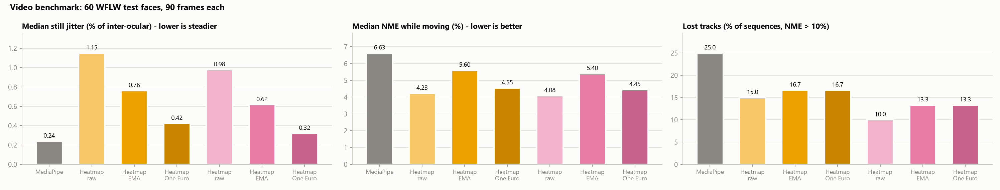
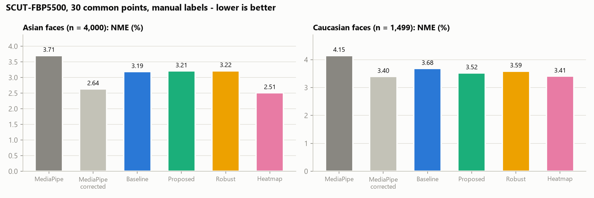
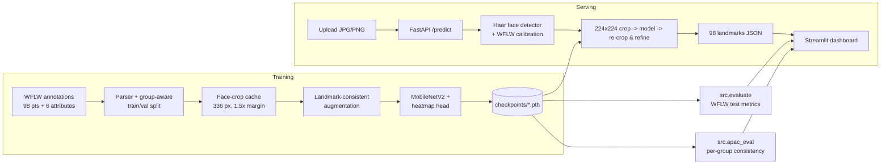

# APAC-Face: A Demographically Robust Facial Landmark Detection System

APAC-Face is a complete, trained 98-point facial landmark detector with a measured baseline comparison,
a robustness analysis, a REST inference API and an interactive dashboard.

> **Problem statement (Cross-Cutting Computer Vision - APAC-Diverse Facial Landmark Detection Model).**
> Existing facial landmark detectors are trained predominantly on Caucasian faces and lose accuracy on
> East, South, and Southeast Asian facial morphology. Build a landmark detection model that performs
> accurately across these populations and quantify the improvement over current baselines.

### What is measured, and what is not

| Question | Data | Evidence type |
|---|---|---|
| How accurate is the model, and how much better than the baseline? | WFLW test set (2,500 faces, ground truth) | **Accuracy** (NME, failure rate, AUC) with a paired bootstrap test |
| Is it more accurate than Google MediaPipe? | Same WFLW test faces, 68 common points | **Accuracy** vs MediaPipe Face Landmarker, also after correcting MediaPipe's labelling-style offset |
| Does it hold up under hard imaging conditions? | WFLW pose / expression / illumination / make-up / occlusion / blur subsets | **Accuracy** per condition. These are *imaging conditions, not demographic groups* |
| Does it behave consistently across East, Southeast and South Asian faces? | FairFace-style APAC images, group labels from the dataset's file names | **Label-free consistency** (flip consistency, crop stability). *Not accuracy*: these images have no landmark ground truth |
| Is it accurate on Asian faces, and how does that compare with Caucasian faces? | SCUT-FBP5500: 4,000 Asian and 1,500 Caucasian faces with **manual landmarks** | **Accuracy** per group on 30 common points, vs MediaPipe, with bootstrap CIs |
| Accuracy on South and Southeast Asian faces | Hand-labelled APAC faces (labelling tool in this repo) | **Accuracy** per group once labelled; no public landmark dataset covers these groups |

Ethnicity is never inferred from facial appearance. WFLW has no demographic labels, so WFLW results alone
do not prove APAC fairness.

<!-- RESULTS:START -->
## Results

All numbers below were measured on this machine (RTX 4050 Laptop GPU, 6 GB). They are produced by
`python -m src.evaluate` and `python -m src.apac_eval` and stored in `results/`. Nothing is hand-entered.
The committed checkpoints were trained with PyTorch 2.6.0 (CUDA 12.4) and evaluated with PyTorch 2.14.1
(CUDA 12.6). The per-epoch training record of each run is in `results/history_<experiment>.json`.

### WFLW test set (2,500 faces, never used for training or checkpoint selection)

| Model | NME | Median NME | FR@10% | AUC@10% | MAE (px) | Improvement vs baseline |
|---|---|---|---|---|---|---|
| Baseline | 7.28% | 5.62% | 17.04% | 0.385 | 3.25 | - |
| Augmented (ablation) | 6.75% | 5.58% | 13.24% | 0.387 | 3.07 | 7.3% |
| **Proposed** | **6.40%** | **5.38%** | **11.84%** | **0.408** | **2.93** | **12.1%** |
| Detector-robust (previous deployed model) | 6.49% | 5.40% | 12.08% | 0.405 | 2.96 | 10.9% |
| Heatmap (multi-scale) | 5.20% | 4.28% | 7.00% | 0.511 | 2.34 | 28.6% |
| **Heatmap + APAC pseudo-labels (deployed)** | **4.99%** | **4.11%** | **6.16%** | **0.525** | **2.24** | **31.4%** |

- **Proposed vs baseline:** mean NME drops by 0.88 points (paired bootstrap 95% CI 0.77 to 1.00; none of the
  2,000 bootstrap resamples showed no gain, i.e. p < 0.0005). The failure rate falls from 17.0% to 11.8%.
- **Where the gain comes from:** augmentation alone gives 7.3%. Attribute-balanced sampling adds a further
  5.2% over augmentation (0.35 points, 95% CI 0.30 to 0.40), so both parts contribute.
- **Heatmap vs detector-robust:** same data, augmentation, sampling and detector-style crops; only the head
  changes (see [Heatmap model](#heatmap-model-architecture-change-for-precision)). NME drops by 1.29 points
  (paired bootstrap 95% CI 1.22 to 1.37), the failure rate falls from 12.1% to 7.0%, and every WFLW condition
  improves (large pose 11.75% -> 8.92%).
- **Latency** (batch 1, 224x224, fp32, this run): regression models 7–12 ms on the GPU and 14–20 ms on the CPU;
  the heatmap model 14.5 ms on the GPU and 28 ms on the CPU. Single-thread ONNX Runtime on the CPU, which is what
  the browser's WebAssembly backend does: 8.8 ms (robust) vs 20.8 ms (heatmap). The heatmap model is the more
  accurate and the slower one, about 2.4x the compute; it has fewer parameters (2.20 M vs 2.98 M).
- Each model was trained once (seed 42). The bootstrap covers test-set sampling, not seed-to-seed variance.


### Against Google MediaPipe (WFLW test, real ground truth)

`python -m src.mediapipe_baseline` runs Google's MediaPipe Face Landmarker (478-point mesh, model
`face_landmarker.task`, mediapipe 1.1.1) on every WFLW test face. MediaPipe and APAC-Face (98 points) are then
reduced to the common **68-point iBUG layout** and scored against the manual annotations reduced the same way.
MediaPipe detected 2,267 of 2,500 faces (90.7%); every number below uses those 2,267 faces for every method.

| Method | NME, 68 pts | Inner face (no jaw) | Mean Euclidean Error | Median point error | Failure rate (NME > 10%) | Points > 8% | Points within 5% / 8% / 10% |
|---|---|---|---|---|---|---|---|
| Google MediaPipe | 8.44% | 6.44% | 6.14 px | 3.52 px | 21.2% | 32.3% | 47.0 / 67.7 / 76.1% |
| MediaPipe, offset-corrected | 7.28% | 5.46% | 5.16 px | 2.78 px | 17.7% | 24.9% | 57.6 / 75.1 / 81.5% |
| Detector-robust, same face location as MediaPipe (previous) | 6.51% | 5.85% | 4.79 px | 2.98 px | 8.8% | 22.0% | 55.2 / 78.0 / 85.8% |
| Heatmap, same face location as MediaPipe | 5.15% | 4.32% | 3.74 px | 2.06 px | 4.2% | 14.1% | 70.7 / 85.9 / 90.6% |
| **Heatmap + pseudo-labels, same face location** (deployed) | **4.99%** | **4.17%** | **3.61 px** | **1.97 px** | **3.7%** | **13.2%** | **72.3 / 86.8 / 91.2%** |
| Proposed, standard WFLW crop | 5.69% | 5.22% | 4.32 px | 2.92 px | 6.5% | 20.8% | 55.7 / 79.2 / 87.3% |
| Detector-robust, standard WFLW crop | 5.74% | 5.24% | 4.34 px | 2.93 px | 7.0% | 21.0% | 55.7 / 79.0 / 86.9% |
| Heatmap, standard WFLW crop | 4.43% | 3.68% | 3.32 px | 2.04 px | 3.2% | 13.2% | 71.4 / 86.8 / 91.5% |

"Points within x%" is the share of all landmarks whose error is below x% of the inter-ocular distance.

- **Same face location** is the fair head-to-head and what the web app runs: our crop is built from MediaPipe's own
  detection (a 3-number box mapping learned on WFLW training faces, one pass). The standard WFLW protocol instead
  crops around the annotated face, which no detector-based system gets in practice.
- **Offset-corrected MediaPipe** gives MediaPipe its best case. Its mesh follows a different landmark convention
  from manual annotation (most visibly on the jaw). So the median per-point offset to ground truth, in an
  eye-aligned frame, is learned on 1,914 WFLW *training* faces and added to its test predictions.
- **The deployed model** (heatmap + APAC pseudo-labels, see
  [self-training](#self-training-on-12000-unlabelled-apac-photos-pseudo-labels)) improves on the heatmap model
  in every row: NME −41% vs MediaPipe and −31% vs offset-corrected MediaPipe (inner face −24%, p < 0.0005).
  The bullets below describe the heatmap model, which introduced the architecture change.
- **Against MediaPipe as shipped**, the heatmap model is better on every metric: NME −38.9% with the same
  face location (95% CI of the drop 3.17–3.40 points), mean error 3.74 vs 6.14 px, failure rate 4.2% vs 21.2%,
  inner-face NME −33.0% (p < 0.0005).
- **Against offset-corrected MediaPipe**, it is also better on all 68 points (−29.2%, CI of the drop 2.00–2.24
  points) **and on the inner face points** (4.32% vs 5.46%, −20.9%, p < 0.0005), in every region and every WFLW
  condition. The previous regression model lost to corrected MediaPipe on the inner face (5.85% vs 5.46%); its
  lead came from the jaw line only. The heatmap head removed that weakness.
- **Caveat:** APAC-Face was trained on WFLW's annotation convention, which favours it on this test set. MediaPipe
  was not trained on WFLW and outputs a 478-point mesh; only its 68 points nearest to iBUG landmarks are scored.

| Region (normalised error) | MediaPipe | MediaPipe corrected | Detector-robust, same location | Heatmap, same location |
|---|---|---|---|---|
| Jawline | 14.43% | 12.71% | 8.48% | **7.66%** |
| Eyebrows | 8.98% | 6.87% | 6.71% | **4.98%** |
| Nose | 5.54% | 4.99% | 5.22% | **3.93%** |
| Eyes | 5.35% | 4.70% | 5.15% | **3.58%** |
| Mouth | 6.24% | 5.43% | 6.13% | **4.61%** |

| WFLW condition (68-pt NME) | MediaPipe | MediaPipe corrected | Detector-robust, same location | Heatmap, same location |
|---|---|---|---|---|
| Large pose | 16.80% | 15.86% | 11.63% | **8.74%** |
| Exaggerated expression | 9.85% | 8.83% | 8.06% | **6.15%** |
| Extreme illumination | 7.78% | 6.58% | 6.00% | **4.83%** |
| Make-up | 7.10% | 6.04% | 5.54% | **4.32%** |
| Occlusion | 10.25% | 9.19% | 8.25% | **7.29%** |
| Blur | 9.33% | 8.25% | 7.22% | **6.09%** |

### Heatmap model: architecture change for precision

**Audit of the previous deployed model (detector-robust), and what limited it.**

| Finding | Evidence | Change |
|---|---|---|
| The head threw away spatial detail. MobileNetV2's 7x7 feature map was globally average-pooled and an MLP regressed 196 numbers, so each point had to be decoded from one 1,280-number vector. | Largest errors on fine structures (eyes 5.15%, mouth 6.13%) where corrected MediaPipe was better | Multi-scale heatmap head with soft-argmax (below) |
| Live landmarks were smoothed with a fixed exponential moving average. A fixed weight either jitters or lags. | Video benchmark (test medians): EMA cut still jitter 0.96% -> 0.63% but raised motion NME 5.88% -> 7.20% (lag) | One Euro filter, tuned on WFLW validation |
| No video metric existed, so stability and lag were never measured. | – | `src/video_eval.py` (below) |
| 98 points vs MediaPipe's 478. | WFLW has 98 manual points per face; no dataset here has manual labels for more | **Kept at 98.** More points would have to be interpolated or copied from MediaPipe, which is not ground truth. Every point drawn is a real model output. |

**Architecture.** The backbone is unchanged (ImageNet MobileNetV2). Features from four depths (strides 4, 8, 16 and
32) are reduced to 96 channels with 1x1 convolutions, merged top-down by upsampling and adding (an FPN-style
decoder), and refined by a 3x3 convolution at stride 4. A 1x1 convolution outputs 98 heatmaps of 56x56. A spatial
softmax turns each into a probability map, and the landmark is its expected position (soft-argmax, "integral
regression"), so the output is still continuous coordinates trained with the same smooth-L1 loss, and the
model stays end-to-end differentiable and exportable to ONNX. The peak probability is a per-point confidence
(`forward_with_confidence`). 2.20 M parameters (regression model: 2.98 M).

**Training.** Identical to `robust`: the same WFLW training split (6,785 faces), augmentation, attribute-balanced
sampling, half of the crops from MediaPipe-style boxes, 60 epochs, checkpoint chosen on MediaPipe-seeded
validation crops (best epoch 57: 4.79% NME vs 5.95% for `robust`). No labels were generated: training uses only
WFLW's manual annotations. The new checkpoint is `checkpoints/heatmap.pth`; `robust.pth` and the other checkpoints
are unchanged.

**Before / after** (WFLW test; no test data was used for training, selection or tuning):

| | Detector-robust (before) | Heatmap (after) | Google MediaPipe |
|---|---|---|---|
| 98-pt NME, standard crop (2,500 faces) | 6.49% | **5.20%** | – |
| 68-pt NME, same face location as MediaPipe (2,267 faces) | 6.51% | **5.15%** | 8.44% (7.28% corrected) |
| Inner-face NME, same location | 5.85% | **4.32%** | 6.44% (5.46% corrected) |
| Mean / median point error, same location | 4.79 / 2.98 px | **3.74 / 2.06 px** | 6.14 / 3.52 px |
| Face failure rate (NME > 10%), same location | 8.8% | **4.2%** | 21.2% |
| Points within 5% of inter-ocular distance | 55.2% | **70.7%** | 47.0% |
| Python app, Haar boxes + 2 refinements (WFLW val, 511 faces) | 4.93% | **3.65%** | – |
| Video: median still jitter (One Euro) | **0.31%** | 0.42% | **0.24%** |
| Video: median motion NME (One Euro) | 6.27% | **4.55%** | 6.63% |
| Video: lost tracks | 23.3% | **16.7%** | 25.0% |
| CPU, single-thread ONNX | **8.8 ms** | 20.8 ms | – |

The refinement setting was re-checked on validation for the new model: Haar boxes 0 / 1 / 2 / 3 passes give
4.23 / 3.81 / **3.65** / 3.60% (2 kept); with MediaPipe seeds a refinement pass changes 4.61% to 4.59%, so the
web app keeps one pass.

### Self-training on 12,000 unlabelled APAC photos (pseudo-labels)

`src/pseudo_labels.py` adds unannotated APAC photos to training with **machine-made labels**. They are not
ground truth. They are stored apart from every human label, marked as machine labels, and never used to
evaluate anything.

1. **Copy.** 12,000 photos (FairFace-style, group in the file name) were copied from the source folder to
   `data/APAC_extra/images/`; the source folder was only read. 55 of them are faces set aside for the
   hand-labelling test set, so they were left out.
2. **Teacher.** The heatmap model labels each face from 10 views: the photo and its mirror image, each with 5
   slightly shifted or scaled crops around MediaPipe's face location. The 10 predictions are averaged.
3. **Reject uncertain faces.** The spread of the 10 views predicts the real error well (rank correlation 0.76
   on WFLW validation). Faces whose views disagree more than the 80th percentile of validation faces were
   dropped. On validation the kept faces' labels had **3.46% NME** (0.4% failures). Averaging alone helps
   little (4.61% → 4.50% NME); the filter is what makes the labels usable.
4. **Kept:** 8,650 faces (1,000 had no face MediaPipe could find, 2,295 were too uncertain): East Asian
   1,252, Southeast Asian 1,101, South Asian 1,283, White 1,520, Latino 1,427, Black 1,224, Middle Eastern 843.
5. **Training (`pseudo` experiment).** Identical to `heatmap`, from scratch, 60 epochs. The only difference:
   30% of every epoch is drawn from these faces, balanced over groups. The checkpoint is selected on WFLW
   validation, as before.

| Test set (human labels) | Heatmap | + APAC pseudo-labels | Difference (95% CI) |
|---|---|---|---|
| WFLW test, 98 points (2,500 faces) | 5.20% | **4.99%** | −0.21 points (−0.16 to −0.26) |
| WFLW test, MediaPipe face location, 68 points | 5.15% | **4.99%** | −0.17 points (−0.14 to −0.19) |
| WFLW large pose / occlusion / blur | 8.92 / 6.55 / 6.11% | **8.61 / 6.19 / 5.83%** | better in all six conditions |
| SCUT-FBP5500 Asian faces (4,000) | **2.51%** | 2.53% | +0.016 points (+0.012 to +0.020) |
| SCUT-FBP5500 Caucasian faces (1,499) | 3.41% | 3.41% | 0.00 (p = 0.93) |

- **On in-the-wild faces, the extra data helps.** WFLW test error drops 4%, and failures fall from 7.0% to
  6.2%. Every condition and region improves.
- **It does not help on SCUT's easy frontal East Asian faces.** There it is 0.016 points worse:
  statistically detectable with 4,000 faces, but under 1% relative. That is not the APAC improvement the data
  was meant to give.
- **Why the gain is limited.** The labels come from the model itself, so they can teach it consistency and
  more face variety, not new knowledge of where points truly are. Hand labels (the labelling tool) remain the
  way to improve accuracy on APAC faces specifically.
- **Status.** Deployed (`inference.default_model` and `web_model`: `pseudo`), as a trade-off: clearly better on
  the in-the-wild test set, a negligible 0.016 points worse on SCUT's frontal East Asian faces. The refinement
  settings were re-checked on validation and stay the same (Haar boxes: 2 passes, 3.51%; MediaPipe seeds: one
  pass, 4.46%). In the browser it matches PyTorch to 0.18 px on average, and on the 70-face gallery it beats
  MediaPipe on 57 of the 58 faces MediaPipe detects (the heatmap model: 55).

### Video benchmark: tracking stability, lag and failures

`python -m src.video_eval` measures what single images cannot. There is no video with per-frame manual
landmarks in this project, so it builds sequences from WFLW faces whose manual annotation is known: each face is
shown still for 1 s, then moves for 2 s (translation up to 60 px, rotation up to 12°, scale ±15%) at 30 fps,
and every frame gets fresh camera noise (Gaussian σ = 6, gain/brightness flicker, JPEG quality 75). Ground truth
per frame is the known transform applied to the manual annotation. MediaPipe runs in VIDEO mode (its own
tracker); APAC-Face runs the live tracker seeded by MediaPipe's face location, exactly as in the web app. All
methods are scored on the 68 common points. Jitter is the temporal spread of each point over the still frames,
as a % of the inter-ocular distance.

The filter was chosen on 40 **validation** faces (grid over One Euro `min_cutoff` 0.3–2 Hz and `beta` 2–40);
the setting that matches MediaPipe's still jitter with the least motion error was kept: `min_cutoff 0.3`,
`beta 20`. For the heatmap model on validation (means over sequences): jitter 1.14% raw -> 0.45% (MediaPipe
0.43%), motion NME 4.45% raw -> 4.88% (MediaPipe 6.95%). Test results, 60 faces x 90 frames (`results/video_benchmark_test.json`):

| Method | Still jitter, median (mean) | Still NME, median | Motion NME, median | Lost tracks | Frames without a face | ms / frame |
|---|---|---|---|---|---|---|
| Google MediaPipe (VIDEO mode) | **0.24%** (1.81%) | 6.22% | 6.63% | 25.0% | 10.0% | 7.6 (CPU) |
| Detector-robust, raw | 0.96% (1.07%) | 5.06% | 5.88% | 21.7% | 5.2% | 11.4 |
| Detector-robust, EMA | 0.63% (0.71%) | 4.97% | 7.20% | 23.3% | 5.2% | 11.4 |
| Detector-robust, One Euro | 0.31% (0.43%) | 4.95% | 6.27% | 23.3% | 5.2% | 11.4 |
| Heatmap, raw | 1.15% (1.25%) | 4.07% | **4.23%** | **15.0%** | 5.2% | 12.3 |
| Heatmap, EMA | 0.76% (0.81%) | 3.96% | 5.60% | 16.7% | 5.2% | 12.3 |
| Heatmap, One Euro | 0.42% (0.50%) | 3.93% | 4.55% | 16.7% | 5.2% | 12.3 |
| Heatmap + pseudo-labels, raw | 0.98% (1.08%) | 3.92% | **4.08%** | **10.0%** | 5.2% | 11.2 |
| Heatmap + pseudo-labels, EMA | 0.62% (0.70%) | 3.86% | 5.40% | 13.3% | 5.2% | 11.2 |
| **Heatmap + pseudo-labels, One Euro (deployed)** | 0.32% (0.41%) | **3.82%** | 4.45% | 13.3% | 5.2% | 11.2 |

(The robust rows come from the earlier run of the same 60 sequences; `results/video_benchmark_test.json` now
holds the heatmap and deployed rows.)

- **Accuracy while tracking:** the deployed setup has 39% lower median error than MediaPipe on still faces
  (3.82% vs 6.22%) and 33% lower on moving faces (4.45% vs 6.63%), and loses about half as many tracks (13.3% vs
  25.0%; a lost track = mean NME over the sequence > 10%).
- **Stability: MediaPipe is still steadier on a typical still face**, though the gap narrowed (median jitter 0.24%
  vs 0.32%; heatmap 0.42%). MediaPipe's mean jitter is worse (1.81%) because of a few sequences where its tracker
  jumps. The One Euro filter cut our raw median jitter by 67% for a 0.4-point motion-error cost; EMA cut it less and
  lagged more.
- **Lag:** the One Euro filter raises motion NME from 4.08% to 4.45%, which is the lag it adds; EMA adds 1.3 points.
- The synthetic motion is a stand-in for real video; per-frame manually annotated video would be needed to
  confirm these numbers on real head motion. APAC-Face ms/frame is the Python tracker on the GPU; MediaPipe runs on
  the CPU.



### Detector-robust model (training on MediaPipe-style crops)

The standard WFLW protocol crops each face around its annotated landmarks, which no real detector can do. With a
detector's box instead, *Proposed*'s NME rises from 5.69% to 6.60%. To shrink that gap, `robust` is trained with the
same recipe as *Proposed* (augmentation + balanced sampling, 60 epochs), with two changes:

- **Training crops:** for half of the training samples, the crop starts from the box the deployed pipeline
  builds from MediaPipe's detection on that training image (`python -m src.mediapipe_baseline --export-boxes`).
  The usual random jitter is applied on top. Training faces MediaPipe misses (4%) get the annotated box shifted
  by a randomly drawn real MediaPipe box error.
- **Checkpoint selection:** the saved epoch is chosen on MediaPipe-seeded validation crops, not on annotated ones.

| WFLW validation | Annotated crop (715 faces) | MediaPipe crop (715) | Haar crop + 2 refinements, Python app (511 Haar detected) |
|---|---|---|---|
| Proposed | 5.32% | 6.07% | 5.11% |
| **Detector-robust** | 5.33% | **5.95%** | **4.93%** |

On the test set, under the deployment condition, it beats *Proposed* by 1.4% (6.51% vs 6.60% NME, 95% CI of the
drop 0.05–0.13 points). On the annotated-crop protocol it is marginally behind (98-point NME 6.49% vs 6.40%). The
gain is real but small. MediaPipe's box errors are mostly within the existing augmentation range: median shift
≈ 0, the middle 90% within about ±3.5% shift and 0.88–1.08× scale, and only 12% outside the ±5% / ±10% jitter.
So most of the remaining gap is information the annotated crop leaks,
not a training-distribution mismatch. `robust` was the deployed model until the heatmap model, trained with the same
recipe, replaced it (`inference.default_model` and `inference.web_model` are now `heatmap`).


### Robustness across WFLW challenge conditions (imaging conditions, not demographic groups)

| Condition | Faces | Baseline NME | Proposed NME | Relative improvement | 95% CI of NME drop (pts) | Heatmap NME |
|---|---|---|---|---|---|---|
| Large pose | 326 | 14.47% | 11.51% | 20.5% | 2.47 to 3.53 | 8.92% |
| Exaggerated expression | 314 | 7.98% | 7.33% | 8.2% | 0.41 to 0.92 | 5.60% |
| Extreme illumination | 698 | 7.16% | 6.20% | 13.4% | 0.74 to 1.18 | 5.15% |
| Make-up | 206 | 6.90% | 6.15% | 10.9% | 0.45 to 1.10 | 5.07% |
| Occlusion | 736 | 8.45% | 7.21% | 14.6% | 0.99 to 1.48 | 6.55% |
| Blur | 773 | 8.38% | 7.03% | 16.0% | 1.07 to 1.62 | 6.11% |

The proposed model improves every condition, and the gap between the hardest condition (large pose) and the
full test set shrinks from 7.2 to 5.1 points. Augmentation alone slightly *hurt* exaggerated expressions
(8.02% vs 7.98%); balanced sampling recovered that. The heatmap model (same data recipe, different head) lowers
every condition further; its large-pose gap to the full test set is 3.7 points.


<!-- APAC:START -->
### APAC demographic groups: label-free consistency (not accuracy)

300 randomly sampled 448x448 face crops per group from the FairFace-style APAC archive (2,100 images). Group
labels come from the archive's file names. These images have **no landmark ground truth**, so the two
metrics below measure stability, not correctness. Lower is better; brackets are 95% bootstrap CIs.

| Group | Haar detection | Flip inconsistency: baseline | proposed | heatmap | heatmap + pseudo (deployed) | Crop instability: baseline | proposed | heatmap | deployed |
|---|---|---|---|---|---|---|---|---|---|
| East Asian | 81% | 5.91% [5.35, 6.49] | 4.39% [3.72, 5.12] | 3.92% [3.06, 5.00] | 3.14% [2.47, 3.96] | 4.32% | 2.15% | 1.69% | 1.55% |
| Southeast Asian | 82% | 5.89% [5.32, 6.49] | 4.11% [3.47, 4.85] | 3.92% [2.97, 5.00] | 3.02% [2.34, 3.75] | 4.26% | 1.97% | 1.71% | 1.40% |
| South Asian (Indian) | 89% | 5.28% [4.80, 5.80] | 3.50% [3.05, 4.02] | 2.93% [2.31, 3.65] | 2.36% [1.82, 3.09] | 4.10% | 1.80% | 1.39% | 1.08% |
| White (reference) | 77% | 6.56% | 4.32% | 4.17% | 3.71% | 4.54% | 2.08% | 1.93% | 1.41% |
| Black (reference) | 75% | 6.65% | 4.64% | 3.77% | 3.73% | 4.57% | 2.11% | 1.87% | 1.53% |
| Latino / Hispanic (reference) | 85% | 5.80% | 4.13% | 3.09% | 2.90% | 4.14% | 1.91% | 1.40% | 1.38% |
| Middle Eastern (reference) | 80% | 6.63% | 5.13% | 4.81% | 3.90% | 4.73% | 2.54% | 2.12% | 1.82% |

**Overlap note for the deployed model:** 225 of these 2,100 photos were among its machine-labelled training
photos. On the photos it never saw, the gain over the heatmap model holds: flip inconsistency East Asian 4.10% →
3.31% (p = 0.002), Southeast Asian 4.23% → 3.29% (p = 0.003), South Asian 3.13% → 2.51% (p = 0.04), and crop
instability falls in all three groups.

How to read this, without over-claiming:

- **The proposed model is more stable in every group:** flip inconsistency falls 26-34% and crop
  instability 50-56% in the three APAC groups (paired bootstrap p < 0.0005 in each). Caveat: the
  augmentation trains exactly these invariances (flips, shifts, scale), so a large improvement is expected
  and is *not* by itself evidence of better accuracy on APAC faces.
- **APAC groups are not worse off than the reference groups.** The proposed model's mean flip inconsistency
  over the three APAC groups (4.00%) is at or below White (4.32%), Black (4.64%) and Middle Eastern (5.13%).
- **The heatmap model is the most stable in every group.** Against the baseline, its flip inconsistency falls by
  2.0 / 2.0 / 2.4 points for East / Southeast / South Asian faces (p < 0.0005 each). Against *proposed* the extra
  gain is small: crop instability drops significantly in all three APAC groups (0.26–0.46 points), but the flip
  gain (0.19–0.57 points) is within noise for East and Southeast Asian faces (p = 0.22 and 0.62). The detector-robust
  regression model was *less* flip-consistent than *proposed* on East and Southeast Asian faces (5.33% and 6.08%);
  the heatmap model does not have that problem.
- **No reliable ranking among the APAC groups.** Their confidence intervals overlap. The max-min spread
  across APAC groups is 0.63 points for the baseline and 0.89 for the proposed model.
- **The face detector varies more than the landmark model.** The Haar detector finds 75-89% of faces
  depending on the group. Faces it misses fall back to a centre crop.
- **What the problem statement asks for**, accuracy per population, still requires an annotated APAC test
  set. `python -m src.apac_eval --annotations ...` computes it as soon as one exists.


<!-- APAC:END -->

### East Asian vs Caucasian accuracy: SCUT-FBP5500 (manual landmarks)

`python -m src.scut_eval` scores every method against **hand-placed** landmarks on
[SCUT-FBP5500](https://github.com/HCIILAB/SCUT-FBP5500-Database-Release): 5,500 frontal faces, 2,000 Asian
women, 2,000 Asian men, 750 Caucasian women, 750 Caucasian men (group labels from the dataset). None of the
models saw these images. One annotation file is empty, which leaves 5,499 faces, and MediaPipe found all of them.

**Point mapping.** SCUT has its own 86-point layout. Only the **30 points with the same anatomical definition**
in both layouts are scored, with nothing interpolated:
- 10 eyebrow points (upper edge)
- 12 eye points (corners, plus the lid points next to each corner)
- the point under the nose tip
- the 7 upper outer lip points

Left out: the jaw (SCUT's outline starts at eyebrow height and continues over the forehead), the nose bridge
and nostrils (SCUT traces the sides of the nose), the lower lip (6 vs 5 points) and the inner lip (absent).
Every ordering the map relies on holds on more than 99.6% of faces. NME uses the labelled outer eye corners.

| Group (faces) | MediaPipe | MediaPipe corrected | Baseline | Detector-robust | Heatmap | **Heatmap + pseudo (deployed)** |
|---|---|---|---|---|---|---|
| Asian (4,000) | 3.71% | 2.64% | 3.19% | 3.22% | **2.51%** | 2.53% |
| Caucasian (1,499) | 4.15% | **3.40%** | 3.68% | 3.59% | 3.41% | 3.41% |
| Asian women / men | 3.66 / 3.76% | 2.57 / 2.70% | 3.25 / 3.12% | 3.32 / 3.11% | **2.47 / 2.56%** | 2.48 / 2.57% |
| Caucasian women / men | 4.02 / 4.28% | 3.20 / **3.59%** | 3.60 / 3.76% | 3.51 / 3.67% | **3.17** / 3.64% | 3.18 / 3.63% |
| Gap, Asian − Caucasian (95% CI) | −0.44 [−0.54, −0.37] | −0.76 [−0.87, −0.69] | −0.49 [−0.59, −0.42] | −0.37 [−0.48, −0.30] | −0.89 [−1.00, −0.82] | −0.88 [−0.98, −0.80] |

- **On Asian faces our two heatmap models are the most accurate methods.** The deployed one (2.53%) has:
  - 32% lower NME than MediaPipe (3.71%; 95% CI of the drop 1.16–1.19 points).
  - 21% lower than the baseline (CI 0.64–0.68 points).
  - 4.1% lower than offset-corrected MediaPipe (CI 0.10–0.12 points).
  - The heatmap model without pseudo-labels is 0.016 points better still (2.51%).
- **On Caucasian faces** the deployed model beats MediaPipe as shipped (−0.74 points) and the baseline
  (−0.28 points). It is **tied with offset-corrected MediaPipe** (3.41% vs 3.40%, p = 0.28).
- **This dataset does not show the premise of the problem statement.** Every method, MediaPipe included, is
  *more* accurate on SCUT's Asian faces than on its Caucasian faces (negative gaps).
  - **Confounded groups:** per the dataset's README, most images come from the internet, some Asian faces
    from two Chinese photo collections and some Caucasian faces from the 10k US Adult Faces database. So
    photo source and quality may differ between the groups along with ethnicity.
  - **What the gap can't show:** it cannot isolate an ethnicity effect.
  - **What it can show:** how methods compare *within* each group, and how the gap differs between methods on
    the same faces. Our gain is larger on Asian faces than on Caucasian ones (vs MediaPipe: +0.45 points more,
    CI 0.42–0.48).
- **Limits.**
  - **Easy photos:** the faces are frontal, unoccluded and neutral, hence the low errors overall. This is not
    a test of hard conditions.
  - **East Asian only:** SCUT's Asian faces are essentially all East Asian; South and Southeast Asian faces
    need the labelling tool.
  - **Labelling convention:** our model learned WFLW's conventions, which may sit closer to SCUT's than
    MediaPipe's do. The offset-corrected column reduces that effect.


<!-- RESULTS:END -->

## System architecture



**Models.** Both start from ImageNet-pretrained MobileNetV2 features on a 224x224x3 crop and output 98 x (x, y)
in [0, 1].

- *Regression head* (`baseline`, `augmented`, `proposed`, `robust`): global average pooling -> Linear(1280->512)
  -> ReLU -> Dropout(0.2) -> Linear(512->196). The head bias starts at the mean training face. 2.98 M parameters.
- *Heatmap head* (`heatmap`, and `pseudo`, which is deployed): multi-scale decoder over strides 4–32 -> 98 heatmaps at 56x56 -> spatial
  softmax -> soft-argmax coordinates, plus a per-point confidence. 2.20 M parameters. See
  [Heatmap model](#heatmap-model-architecture-change-for-precision).

**Crop protocol.** Training and test crops are squares centred on the landmark extent, with side = 1.2 x the
longer side (the standard WFLW protocol). For uploaded photos, an OpenCV Haar detector box is mapped to that
crop with a calibration fitted on WFLW training images (median over 562 matched faces: side x 1.03, centre
shifted down by 0.15 x box height). After each prediction the crop is recomputed from the predicted
landmarks exactly as in training, and the face is predicted again. The number of passes was tuned on the
WFLW **validation** split with real detector boxes, not on the test set:

| Refinement passes | NME from Haar boxes (511 val faces), proposed / heatmap | NME from a loose box (detector-miss fallback), proposed / heatmap |
|---|---|---|
| 0 | 5.98% / 4.23% | 20.57% / 15.32% |
| 1 | 5.27% / 3.81% | 11.59% / 9.49% |
| **2 (default)** | **5.11% / 3.65%** | **9.36% / 8.80%** |
| 3 | 5.03% / 3.60% | 8.86% / 8.64% |

The Haar detector found 71% of WFLW validation faces. WFLW is deliberately hard (profiles, occlusion); on
FairFace-style APAC crops the detection rate per group is reported in `results/apac_consistency.json`.

## Experiments

All configurations share the backbone, optimiser (AdamW, backbone lr 1e-4, head lr 1e-3), smooth-L1
loss (beta 0.01 in normalised coordinates), ReduceLROnPlateau schedule, early stopping (patience 10 on
validation NME), mixed precision, seed 42 and a 60-epoch budget. Only the training data pipeline changes:

| Experiment | Augmentation | Sampling | Purpose |
|---|---|---|---|
| `baseline` | none | uniform | standard fine-tuning baseline |
| `augmented` | flip (with left/right index remapping), rotation +/-20 deg, scale +/-10%, shift +/-5%, brightness/contrast +/-25%, blur, grayscale, synthetic occlusion | uniform | ablation: effect of augmentation alone |
| `proposed` | same as `augmented` | attribute-balanced | full method |
| `robust` | same as `augmented`, half of the crops from MediaPipe-style boxes | attribute-balanced | detector-robust regression; checkpoint chosen on MediaPipe-seeded validation |
| `heatmap` | same as `robust` | attribute-balanced | `robust` recipe with the multi-scale heatmap head |
| `pseudo` | same as `robust` | attribute-balanced, plus 30% machine-labelled APAC faces | `heatmap` + self-training; deployed model |

Attribute-balanced sampling up-weights faces with rare WFLW conditions: each attribute gives a face the
weight 0.5 / P(its value), weights are averaged over the six attributes, and the average is raised to the
power 0.5.

**Metrics.** NME = mean point-to-point error / inter-ocular distance (outer eye corners, points 60 and 72).
FR@10% = share of faces with NME > 10%. AUC@10% = area under the cumulative error curve up to 10%.
MAE = mean absolute coordinate error in original-image pixels. Latency = median forward time at batch size 1.
Invalid predictions (NaN/inf) count as failures. Relative improvement = (NME_baseline - NME_proposed) /
NME_baseline x 100.

## Repository layout

```
APAC-Face/
├── config.yaml              all hyperparameters, paths and experiment definitions
├── requirements.txt
├── src/
│   ├── dataset.py           WFLW parser, group-aware split, face-crop cache, PyTorch dataset
│   ├── augmentations.py     one affine matrix for image + landmarks; flip index remapping
│   ├── landmarks.py         98-point mirror permutation, mesh topology, drawing
│   ├── model.py             MobileNetV2 regression and heatmap models, checkpoint save/load
│   ├── train.py             training loop: AMP, early stopping, resume, balanced sampling
│   ├── metrics.py           NME, MAE, FR, AUC/CED, bootstrap tests
│   ├── evaluate.py          WFLW test evaluation, tables and figures
│   ├── apac_eval.py         per-group consistency (and accuracy, given annotations)
│   ├── apac_labels.py       hand-labelled APAC test set: prepare faces, progress, per-group accuracy
│   ├── pseudo_labels.py     machine labels for unannotated APAC photos (self-training)
│   ├── scut_eval.py         Asian vs Caucasian accuracy on SCUT-FBP5500 (manual landmarks)
│   ├── serve_web.py         web server: cross-origin isolation + label storage for the labelling tool
│   ├── inference.py         face detection, crop, predict, refine; CLI
│   ├── live.py              webcam / video mode: face tracking + One Euro smoothing
│   ├── video_eval.py        video benchmark: jitter, lag and lost tracks vs MediaPipe
│   ├── mediapipe_baseline.py Google MediaPipe benchmark on WFLW (68 common points)
│   ├── export_web.py        ONNX export + data for the web app
│   ├── plotting.py          report figures
│   └── utils.py             config, seeding, device, JSON helpers
├── backend/main.py          FastAPI service
├── frontend/                Streamlit dashboard (app.py + views/)
├── web/                     Faceify web app: index.html, label.html (labelling tool), js/, styles/, models/, data/
├── checkpoints/             trained inference weights + detector calibration
├── results/                 metrics, CSV tables, figures, training logs
├── scripts/                 train_all.ps1, run_app.ps1
├── tests/                   pytest suite (no dataset needed except one optional test)
└── data/                    datasets (git-ignored, see data/README.md)
```

## Installation

Developed and tested on Windows 11 with Python 3.13 and an NVIDIA RTX 4050 Laptop GPU (6 GB). It needs
Python >= 3.10. CUDA is used when available, otherwise the CPU.

```bash
python -m venv .venv
# Windows: .venv\Scripts\activate      Linux/macOS: source .venv/bin/activate
pip install torch torchvision --index-url https://download.pytorch.org/whl/cu126
pip install -r requirements.txt
```

For the MediaPipe benchmark and the web export:

```bash
pip install mediapipe --no-deps     # its opencv-contrib-python 5.x dependency would replace opencv-python<5
pip install absl-py flatbuffers onnx onnxruntime onnxscript
```

`requirements-lock.txt` pins the exact versions this project was tested with. Use it instead of
`requirements.txt` to reproduce the environment exactly.

## Dataset setup

1. Download WFLW from the links in the [LAB repository](https://github.com/wywu/LAB): `WFLW_images.tar.gz`
   (Google Drive / Baidu) and `WFLW_annotations.tar.gz`.
2. Extract both into `data/WFLW/`:

   ```bash
   tar -xzf WFLW_images.tar.gz -C data/WFLW
   tar -xzf WFLW_annotations.tar.gz -C data/WFLW
   ```

3. Parse, split and cache face crops (also checks the attribute flags against the official subset lists and
   writes `results/dataset_samples.png`):

   ```bash
   python -m src.dataset
   ```

Optional, for the Asian vs Caucasian test: download SCUT-FBP5500 (172 MB, non-commercial research use only)
from the Google Drive link in its [GitHub repository](https://github.com/HCIILAB/SCUT-FBP5500-Database-Release)
and extract it to `data/SCUT-FBP5500/` (so `data/SCUT-FBP5500/SCUT-FBP5500_v2/Images/` exists).

If the files are missing, every command prints the expected layout instead of crashing. See
[data/README.md](data/README.md).

## Training

```bash
python -m src.train --experiment baseline
python -m src.train --experiment augmented
python -m src.train --experiment proposed
python -m src.mediapipe_baseline                       # once: learns MediaPipe's box mapping (needs mediapipe)
python -m src.mediapipe_baseline --export-boxes        # MediaPipe-style boxes, needed by the next run
python -m src.train --experiment robust                # detector-robust regression
python -m src.train --experiment heatmap               # same recipe, heatmap head
python -m src.pseudo_labels copy --source path/to/unlabelled_photos   # self-training data (source only read)
python -m src.pseudo_labels check                       # is the 10-view teacher better? (WFLW val)
python -m src.pseudo_labels label                       # machine labels -> data/cache/pseudo.npz
python -m src.train --experiment pseudo                # deployed model (heatmap + pseudo-labels)
python -m src.train --experiment proposed --resume      # continue an interrupted run
python -m src.train --experiment baseline --smoke       # 2-epoch pipeline check
```

Or run everything (dataset cache, the three trainings, detector calibration, evaluation) in one go on Windows:

```powershell
powershell -ExecutionPolicy Bypass -File scripts\train_all.ps1
```

Each run writes `checkpoints/<experiment>.pth` (best validation NME, weights only, committed),
`checkpoints/<experiment>_last.pth` (full state for `--resume`, git-ignored),
`results/history_<experiment>.json` (per-epoch losses, validation NME, learning rate, epoch time) and
`results/logs/train_<experiment>.log`. The batch size is capped automatically on GPUs with little VRAM.
On this machine each 60-epoch run took about 25 minutes.

## Evaluation

```bash
python -m src.inference --calibrate-detector     # fit the face-detector -> crop mapping on WFLW train
python -m src.evaluate                           # WFLW test: metrics.json, CSVs, figures
python -m src.mediapipe_baseline                 # Google MediaPipe vs APAC-Face on the same faces
python -m src.apac_eval --source "path/to/APAC asian images.zip" --per-group 300
python -m src.scut_eval                          # Asian vs Caucasian accuracy, SCUT-FBP5500 manual landmarks
python -m src.video_eval --split val --faces 40 --tune  # choose the live filter (validation only)
python -m src.video_eval --split test --faces 60        # video jitter / lag / lost-track benchmark
```

### Hand-labelled APAC test set (labelling tool)

The APAC archive has group labels but no landmarks, so per-population **accuracy** needs human labels. The
labelling tool collects them:

```bash
python -m src.apac_labels prepare --per-group 50   # 50 faces per group -> web/labeling/ (git-ignored)
python -m src.serve_web                            # open http://127.0.0.1:8080/label.html
python -m src.apac_labels status                   # progress per group and annotator
python -m src.apac_labels evaluate                 # accuracy per group vs the human labels
```

- **68 points per face** (iBUG layout: the 68 points every comparison here is scored on).
- **Neutral starting shape.** Each face starts from the mean WFLW training face, placed in a box around the face
  (the box comes from MediaPipe's face location, or the image centre if it finds no face). No model's landmark
  prediction is ever shown, so the labels do not lean towards APAC-Face or MediaPipe.
- **Tool:** click to place the highlighted point (the next one is then highlighted), drag to correct, zoom and
  pan, a 4x magnifier while dragging, a reference diagram and written instructions for every point, "hidden
  point" flags, undo, skip with a reason, and a timer. The default queue interleaves East Asian, Southeast Asian,
  South Asian and the White reference group so all four fill up together.
- **Storage:** `src/serve_web.py` saves each face to `data/apac_labels/<annotator>/<id>.json` (git-ignored, like
  all dataset files). If the page is served without it, labels stay in the browser and can be downloaded.
- **Second opinions:** the "Second opinion" queue shows faces another annotator labelled. `evaluate` reports
  the inter-annotator disagreement. Differences between models smaller than that are within labelling noise.
- **Evaluation** scores MediaPipe (raw and offset-corrected) and every checkpoint against the labels on the faces
  MediaPipe finds, with APAC-Face located by MediaPipe's face detection as in the web app. It reports NME,
  inner-face NME, failure rates and regions per group, the **gap of each group to the White reference**, and
  paired bootstrap tests of the deployed model against MediaPipe and the baseline
  (`results/apac_labelled_accuracy.json`, `results/apac_labelled_per_face.csv`).
- About 3–5 minutes per face. With 50 faces per group, a group's mean NME is known to roughly ±1 point (95%,
  judging by the per-face spread on WFLW); paired model-vs-model differences on the same faces are tighter.
  More faces per group narrow both.

### Evaluating on an annotated APAC set

To measure real per-population accuracy, annotate APAC faces in the WFLW 98-point line format
(196 coordinates, optionally the rectangle and six attribute flags, then the image path) and run:

```bash
python -m src.apac_eval --annotations apac_test.txt --images data/APAC_annotated --groups groups.csv
```

Groups are read from `{id}_{Group}.jpg` file names or from a CSV with columns `image,group`. The output,
`results/apac_annotated_accuracy.json`, holds per-group NME, failure rate and the baseline-vs-proposed
bootstrap test.

## Running the application

```bash
# terminal 1 - inference API
uvicorn backend.main:app --host 127.0.0.1 --port 8000
# terminal 2 - dashboard (falls back to in-process inference if the API is not running)
streamlit run frontend/app.py
```

On Windows, `scripts\run_app.ps1` starts both. The dashboard opens at http://localhost:8501 with six pages:
Overview, Landmark Detection (upload, overlay, download), Live Camera, Model Comparison, Robustness Analysis
and About.

Single-image command line:

```bash
python -m src.inference --image face.jpg --out results/predictions/face.png   # deployed model (pseudo)
```

### Faceify web app (browser, both models on-device)

`web/` is the Faceify landmark-analysis site (originally `D:\AntiPro`), with the same sections and features,
restyled in the warm editorial look of faceifylabs.com (cream paper, ink text, sage accent, Newsreader serif
headings over DM Sans, pill buttons, hairline tables). Two things changed in function:

- **"Optimized for Diverse Faces" is now the trained APAC-Face network** (the deployed model, heatmap + pseudo-labels),
  running in the browser through ONNX Runtime Web (`web/models/apac_face.onnx`). It used to be MediaPipe
  remapped to 68 points.
- **The baseline is Google MediaPipe Face Landmarker** (`@mediapipe/tasks-vision`), loading the same
  `face_landmarker.task` file the Python benchmark scores. It replaces the deprecated FaceMesh script.

```bash
python -m src.export_web --apac-source "path/to/APAC asian images.zip"   # model, galleries, results
python -m src.serve_web                                                  # then open http://localhost:8080
```

The API also serves it at http://127.0.0.1:8000/web/ whenever `uvicorn backend.main:app` is running. Both send
the cross-origin isolation headers (COOP/COEP) that let ONNX Runtime Web use 4 WebAssembly threads; a plain
`python -m http.server` also works, but single-threaded and about 1.8x slower. The page
needs internet access for the ONNX Runtime and MediaPipe scripts (jsDelivr CDN). Photos never leave the browser.

- **Mean Euclidean Error, NME, Maximum Landmark Error and Failure Rate (>8% NME)** are computed live in the
  browser for **both** models on the same 68 points. They appear whenever the face has real ground truth: the
  WFLW benchmark faces (manual annotations) or an annotation file you upload for your own photo. A
  side-by-side table marks the winner per metric.
- **Webcam and unannotated photos** have no ground truth, so the page shows the measured benchmark errors and the
  live disagreement between the two models instead of an invented error.
- **Ground truth is real only.** The original app derived every sample's "ground truth" from one 68-point
  template face (`BASE_TEMPLATE_68`), and generated it for any unannotated image too. Its error numbers measured
  the distance to a template, not to the real landmarks. That code is gone.
- **Verified:** for the same image and crop, the browser model and the PyTorch model differ by 0.18 px on average
  (1.1 px max, face with a 111 px inter-ocular distance; the canvas and OpenCV resample the crop slightly
  differently). On the 70-face WFLW gallery, most of it the hardest challenge conditions, the deployed model beat
  MediaPipe on 57 of the 58 faces MediaPipe detected:

  | 58 gallery faces, in the browser | Mean Euclidean Error | NME | Maximum Landmark Error | Failure Rate (>8% NME) |
  |---|---|---|---|---|
  | Google MediaPipe | 11.01 px | 10.74% | 34.4 px | 39.5% |
  | APAC-Face, detector-robust (before) | 9.06 px | 8.75% | 20.8 px | 28.5% |
  | APAC-Face, heatmap | 7.68 px | 7.36% | 20.5 px | 17.8% |
  | **APAC-Face, heatmap + pseudo-labels (deployed)** | **7.44 px** | **7.11%** | **19.7 px** | **16.1%** |
- **Live mode** tracks the face from frame to frame, with MediaPipe re-checking every 15 frames. Our model runs in
  about 70 ms per frame on the CPU (WebAssembly, 4 threads), about 14 FPS (124 ms with one thread; the previous
  regression model took about 60 ms with one thread). When MediaPipe finds no face on a
  photo, APAC-Face runs on a centred crop with two refinement passes and says so.
- The WFLW and APAC gallery images and annotations are generated locally and git-ignored (dataset licences). The
  model, metadata and measured results are committed.

### Live webcam detection

```bash
python -m src.inference --webcam                                  # q / Esc quit, m toggle mesh, s snapshot
python -m src.inference --webcam --camera 1 --record demo.mp4     # another camera, save the annotated video
python -m src.inference --video clip.mp4 --headless --record out.mp4
```

The dashboard's **Live Camera** page has the same live view: it streams the webcam of the computer running
the dashboard. Its **Snapshot** tab instead takes a photo with the browser's camera, after you opt in.

Live mode (`src/live.py`) does not run the face detector on every frame. After the first detection, each
frame is cropped around the previous frame's landmarks, which is the same crop convention the model was
trained on. The Haar detector re-checks every 15 frames: it re-seeds the track if the face moved elsewhere,
and drops it after two consecutive misses. Landmarks are smoothed with a One Euro filter (`live.filter`): a
low-pass filter whose cutoff rises with the landmarks' speed (normalised by the face size), so a still face is
heavily smoothed and a moving face is followed with little lag. The next crop is always computed from the raw
(unfiltered) landmarks, so smoothing never feeds back into tracking. `ema` and `none` remain available, and the
web app uses the same filter and settings (exported in `model_meta.json`). See the
[video benchmark](#video-benchmark-tracking-stability-lag-and-failures) for measured jitter and lag. On a synthetic 640x480 motion clip (an APAC face panning, zooming and rotating),
the proposed model tracked the face in 90/90 frames at about 64 FPS (9 ms model time per frame, RTX 4050,
no display). Settings live under `live:` in `config.yaml`.

## API

Interactive docs: http://127.0.0.1:8000/docs

| Method | Path | Description |
|---|---|---|
| GET | `/health` | status, loaded models, missing checkpoints, device, detector |
| GET | `/models` | metadata of every loaded model (best epoch, validation NME) |
| POST | `/predict` | multipart `file` (JPG/PNG, <= 10 MB); query `model`, `return_image`, `draw_mesh` |
| POST | `/compare` | runs several models (`models` query, default all) on one upload; reports inter-model disagreement |
| GET | `/metrics` | contents of `results/metrics.json` and `results/apac_consistency.json` |

```bash
curl -F "file=@face.jpg" "http://127.0.0.1:8000/predict?model=proposed"
```

```json
{
  "landmarks": [[412.3, 518.9], "... 98 points in image pixels"],
  "num_landmarks": 98,
  "box": [455.1, 470.8, 512.4],
  "face_detected": true,
  "faces_found": 1,
  "model_ms": 9.8,
  "total_ms": 41.2,
  "model": "proposed",
  "image_size": [960, 1280],
  "warnings": [],
  "note": "Uploaded images have no ground-truth landmarks, so no accuracy metric is computed."
}
```

Errors: 415 for unsupported file types, 413 for oversized files, 400 for undecodable images, 404 for unknown
models, and 503 when no checkpoint is loaded.

## Tests

```bash
pytest -q
```

The suite covers the annotation parser, the train/val split, the flip permutation, image/landmark consistency
under augmentation, the metrics, the model and checkpoints, inference, the API, and live-mode tracking
(detect, track, re-seed, drop, headless video recording).

## Limitations

- **No demographic ground truth in WFLW.** WFLW results measure accuracy and robustness to imaging conditions,
  not accuracy on East, South or Southeast Asian faces.
- **The APAC analysis is label-free.** Flip and crop consistency catch unstable predictions, but a model that
  is consistently biased the same way would still score well. Per-population accuracy needs annotated APAC
  faces.
- **Coarse labels.** The APAC group labels are annotator-perceived categories from dataset metadata. Treat
  them as approximate.
- **98 points, not 478.** The model predicts WFLW's 98 manually annotated points. A denser output would need
  denser manual ground truth; interpolating points or copying MediaPipe's mesh would only look denser.
- **Lightweight model.** The heatmap head on MobileNetV2 is far more accurate than the regression head, but still
  small next to research models such as HRNet or STAR. It is also about 2.4x slower on the CPU than the
  regression model.
- **Stability.** On a typical still face MediaPipe's tracking is steadier (median jitter 0.24% vs 0.42% of the
  inter-ocular distance). The video benchmark is synthetic motion of real annotated faces, not real video.
- **Single seed.** Each configuration is trained once (seed 42), so differences within the bootstrap CI
  should not be over-read.
- **MediaPipe comparison across conventions.** MediaPipe's mesh vertices are not WFLW annotation points, so its
  raw numbers include a labelling-style gap. The offset-corrected row removes most of it. APAC-Face has a home
  advantage on WFLW: it learned WFLW's labelling convention, MediaPipe did not.
- **Detector box gap.** With a detector's box instead of the annotated crop, NME rises (heatmap: 4.43% -> 5.15%,
  68 points). Training on MediaPipe-style crops closed only a small part of this gap for the regression model.
- **Weak face detector.** The Haar detector is frontal-only. When it misses a face, the image is treated as a
  centred face crop, and the dashboard says so.

## Future work

- Annotate a consented APAC landmark test set (50-100 faces per group) and report per-group NME.
- Semi-supervised adaptation on unlabelled APAC faces with equivariance / flip-consistency losses.
- Wing / Adaptive-Wing loss, a higher-resolution or stronger backbone, a stronger detector (YuNet, RetinaFace).
- Real videos with per-frame manual landmarks to validate the jitter and lag numbers.
- Multiple seeds with mean +/- std reporting; ONNX / TensorRT export for edge deployment.

## Acknowledgements and data licences

- WFLW: W. Wu, C. Qian, S. Yang, Q. Wang, Y. Cai, Q. Zhou. *Look at Boundary: A Boundary-Aware Face Alignment
  Algorithm.* CVPR 2018. Research use only; not redistributed here.
- The APAC image archive follows the FairFace layout (86,744 training crops, seven race categories):
  K. Kärkkäinen, J. Joo. *FairFace: Face Attribute Dataset for Balanced Race, Gender, and Age.* WACV 2021.
  Not redistributed here.
- SCUT-FBP5500: L. Liang, L. Lin, L. Jin, D. Xie, M. Li. *SCUT-FBP5500: A Diverse Benchmark Dataset for
  Multi-Paradigm Facial Beauty Prediction.* ICPR 2018. Non-commercial research use only; not redistributed here.
- MobileNetV2 ImageNet weights from torchvision.
- Google MediaPipe Face Landmarker (`web/models/face_landmarker.task`) and `@mediapipe/tasks-vision`: Apache-2.0.
  ONNX Runtime Web: MIT.
- The Faceify web app design and features come from the author's earlier `AntiPro` project.
